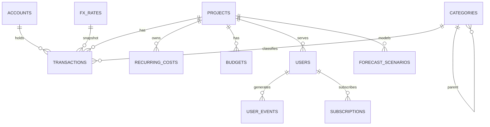

# 项目财务与经营分析平台 · 系统设计文档

> 代号：**FBAP**（Finance & Business Analytics Platform）
> 记账本位币：**人民币（CNY）**，所有金额自动折算并展示**美元（USD）**
> 版本：v1.0（设计定稿待评审）
> 形态：多项目统一聚合的 Web 管理后台

---

## 1. 目标与范围

### 1.1 目标

1. **统一台账**：多项目、多账户、多维度的收支记录，人民币计价 + 自动美元折算。
2. **长期运营成本管理**：云资源、订阅、人力等周期性成本的持续跟踪与预警。
3. **收入分析**：按项目/渠道/地区/产品/时间多维下钻，看清收入结构与增长质量。
4. **用户行为习惯分析**：将用户行为事件与收入挂钩，做转化漏斗与留存归因。
5. **财务模型预测**：基于历史与假设的现金流预测、盈亏平衡、多情景 What-if。

### 1.2 范围边界（本期）

| 在范围内 | 不在范围内（后续） |
|---|---|
| 收支台账、科目体系、账户管理 | 银行/支付网关自动对账（先预留接口） |
| 汇率快照与双币展示 | 多级审批工作流、报销单据流转 |
| 运营成本台账与单位成本分析 | 完整总账/会计凭证（GAAP/IFRS 记账） |
| 收入多维分析、用户行为分析 | 真正的税务申报与发票系统对接 |
| 现金流预测与情景模拟 | 自动投资组合/资金调度 |

### 1.3 角色

| 角色 | 权限 |
|---|---|
| Owner 所有者 | 全部项目、全部数据、科目与汇率配置 |
| Admin 财务管理员 | 录入/编辑流水、维护科目与预算、查看全部报表 |
| Operator 运营 | 录入本人项目流水、查看本项目报表 |
| Viewer 只读 | 仅查看授权项目看板 |

---

## 2. 总体架构

```
┌──────────────────────────────────────────────────────────┐
│  前端  React 19 + Vite + TypeScript + shadcn/ui          │
│  + Tailwind + RTK Query      （深色主题 / 双币展示）      │
└───────────────┬──────────────────────────────────────────┘
                │  HTTPS / REST (JWT)
┌───────────────▼──────────────────────────────────────────┐
│  后端  Fastify (Node.js 22)                              │
│  ├─ 领域服务：ledger / cost / revenue / behavior / forecast │
│  ├─ 汇率服务：抓取 + 快照 + 缓存                          │
│  ├─ 集成适配层：R2 用量 / 支付渠道 / 会员体系 API         │
│  ├─ 任务调度：周期成本摊销、日汇率、月度滚动预测          │
│  └─ 报表聚合：预聚合物化表 + 按需查询                     │
└───────────────┬──────────────────────────────────────────┘
                │  mysql2 (连接池)
┌───────────────▼──────────────────────────────────────────┐
│  数据层  MySQL 8.0.x（独立实例/独立库）                   │
│  Redis（可选）：汇率缓存、报表缓存、调度锁                │
└──────────────────────────────────────────────────────────┘
```

### 2.1 技术选型

| 层 | 选型 | 说明 |
|---|---|---|
| 前端 | React 19 + Vite + TS + shadcn/ui + Tailwind + RTK Query | 复用现有习惯；深色主题 |
| 图表 | Recharts / ECharts | 趋势、漏斗、瀑布图、情景对比 |
| 后端 | Fastify + TypeScript（Node 22） | 与现有 Vidday 后端技术栈一致 |
| 数据库 | **MySQL 8.0.x**（建议独立实例） | 需要窗口函数 / CTE / 8.0 优化器 |
| 缓存/队列 | Redis + BullMQ（可选） | 汇率缓存、定时聚合、成本摊销 |
| 调度 | node-cron / BullMQ repeatable | 日汇率、月度预测、成本摊销 |
| 鉴权 | JWT + RBAC | 项目级数据隔离 |
| 部署 | Docker Compose（MySQL + Redis + API + Web） | 便于本地与云上一致 |

---

## 3. 汇率机制（双币核心）

### 3.1 原则

1. **本位币记账**：所有流水以 **CNY 原值**存储（`amount_cny`），同时记录**发生日汇率快照**（`fx_rate`）。
2. **美元可复现**：每笔流水的美元值 = `amount_cny / fx_rate`，汇率快照随流水落库，历史报表不会因后续汇率波动而改变。
3. **看板双显示**：列表与卡片统一「¥ 主值 / \$ 副值」；看板汇总可切换「按快照汇率」或「按最新汇率」两种口径（默认快照）。
4. **多源容错**：汇率优先自动抓取（如外汇中间价 API），抓取失败允许手动录入，缺失则向前取最近一个有效值。

### 3.2 表设计

```sql
CREATE TABLE fx_rates (
  id            BIGINT UNSIGNED AUTO_INCREMENT PRIMARY KEY,
  rate_date     DATE           NOT NULL,          -- 汇率日期
  base_ccy      CHAR(3)        NOT NULL DEFAULT 'CNY',
  quote_ccy     CHAR(3)        NOT NULL DEFAULT 'USD',
  rate          DECIMAL(18,8)  NOT NULL,          -- 1 USD = ? CNY
  source        VARCHAR(32)    NOT NULL,          -- api / manual
  created_at    DATETIME       NOT NULL DEFAULT CURRENT_TIMESTAMP,
  UNIQUE KEY uk_fx (rate_date, base_ccy, quote_ccy)
) ENGINE=InnoDB DEFAULT CHARSET=utf8mb4;
```

> 已支持多币种扩展：如需港币/新币计价，仅需新增 `quote_ccy` 记录，展示层按需折算。

---

## 4. 收支科目体系（覆盖项目各领域）

科目为**树形结构**，每个科目带 `type`（income/expense）与 `domain`（领域标签），便于「按领域」聚合与分摊。

### 4.1 收入科目（income）

| 领域 domain | 科目示例 |
|---|---|
| Subscription 订阅 | 月度订阅、季度订阅、年度订阅、自动续费 |
| Transactional 点播 | 单片付费(TVOD)、下载付费、解锁剧集 |
| Advertising 广告 | 贴片/前贴、展示广告、品牌定制、激励视频 |
| Licensing 版权分发 | 版权授权、渠道分发分成、海外发行、二次分销 |
| Value-added 增值周边 | 数字商品、实体周边、打赏、会员礼包 |
| Sponsorship 赞助 | 冠名、项目赞助、联合出品 |
| Platform 平台激励 | 平台补贴、创作者激励、扶持基金 |
| Financial 金融 | 利息、理财收益、汇兑收益 |
| Other 其他 | 政府补贴、退款冲减（负向）、杂项 |

### 4.2 支出科目（expense）

| 领域 domain | 科目示例 |
|---|---|
| Infra 基础设施 | 对象存储(R2)、CDN 出流量、云主机/计算、数据库、带宽、域名、SSL |
| Compute 算力 | 转码/编码、DRM 授权(Widevine/FairPlay/PlayReady)、P2P 节点、AI 推理(元数据补全/OCR) |
| Content 内容 | 版权采购、内容制作、修复转制、字幕(PGS)、配音配乐 |
| People 人力 | 全职薪资、社保公积金、外包/自由职业、顾问、招聘 |
| Marketing 市场 | 广告投放、Affiliate 佣金、KOL/达人、ASO、活动、SEO |
| Platform 平台渠道 | 应用商店分成(Apple/Google)、支付手续费(Stripe/微信/支付宝)、发行分成 |
| G&A 管理 | 办公、设备与折旧、软件订阅(SaaS)、法务、税务、审计、财务费用、差旅、保险 |
| Other 其他 | 杂项、坏账、罚款 |

### 4.3 科目表设计

```sql
CREATE TABLE categories (
  id          BIGINT UNSIGNED AUTO_INCREMENT PRIMARY KEY,
  parent_id   BIGINT UNSIGNED NULL,             -- 树形父节点
  name_cn     VARCHAR(64) NOT NULL,
  name_en     VARCHAR(64) NOT NULL,
  type        ENUM('income','expense') NOT NULL,
  domain      VARCHAR(24) NOT NULL,             -- Infra/Content/People/...
  is_recurring TINYINT(1) NOT NULL DEFAULT 0,   -- 是否典型周期科目
  is_cogs     TINYINT(1) NOT NULL DEFAULT 0,    -- 是否为营业成本(用于毛利)
  sort_order  INT NOT NULL DEFAULT 0,
  status      TINYINT(1) NOT NULL DEFAULT 1,
  KEY idx_tree (parent_id, type, sort_order)
) ENGINE=InnoDB DEFAULT CHARSET=utf8mb4;
```

---

## 5. 数据模型

### 5.1 ER 概览



### 5.2 核心表 DDL（要点）

```sql
-- 项目
CREATE TABLE projects (
  id         BIGINT UNSIGNED AUTO_INCREMENT PRIMARY KEY,
  code       VARCHAR(32)  NOT NULL UNIQUE,      -- vidday / moive-db ...
  name_cn    VARCHAR(64)  NOT NULL,
  name_en    VARCHAR(64)  NOT NULL,
  status     ENUM('active','paused','archived') NOT NULL DEFAULT 'active',
  launch_date DATE NULL,
  created_at DATETIME NOT NULL DEFAULT CURRENT_TIMESTAMP
) ENGINE=InnoDB DEFAULT CHARSET=utf8mb4;

-- 资金账户（现金/银行/平台余额/信用卡）
CREATE TABLE accounts (
  id         BIGINT UNSIGNED AUTO_INCREMENT PRIMARY KEY,
  name_cn    VARCHAR(64) NOT NULL,
  name_en    VARCHAR(64) NOT NULL,
  type       ENUM('cash','bank','platform','credit','virtual') NOT NULL,
  currency   CHAR(3) NOT NULL DEFAULT 'CNY',
  opening_balance_cny DECIMAL(18,2) NOT NULL DEFAULT 0,
  status     TINYINT(1) NOT NULL DEFAULT 1
) ENGINE=InnoDB DEFAULT CHARSET=utf8mb4;

-- 流水（收入/支出统一）
CREATE TABLE transactions (
  id             BIGINT UNSIGNED AUTO_INCREMENT PRIMARY KEY,
  project_id     BIGINT UNSIGNED NOT NULL,
  account_id     BIGINT UNSIGNED NULL,
  category_id    BIGINT UNSIGNED NOT NULL,
  direction      ENUM('income','expense') NOT NULL,
  txn_date       DATE NOT NULL,
  amount_cny     DECIMAL(18,2) NOT NULL,        -- 本位币原值（支出为正数，方向由 direction 决定）
  fx_rate        DECIMAL(18,8) NOT NULL,        -- 1 USD = ? CNY 快照
  amount_usd     DECIMAL(18,2) AS (ROUND(amount_cny / fx_rate, 2)) STORED,
  src_currency   CHAR(3) NOT NULL DEFAULT 'CNY',
  src_amount     DECIMAL(18,2) NULL,            -- 原始币种金额（如境外付款）
  is_recurring   TINYINT(1) NOT NULL DEFAULT 0,
  recurring_id   BIGINT UNSIGNED NULL,          -- 由哪个周期成本模板生成
  counterparty   VARCHAR(128) NULL,             -- 交易对手/供应商
  ref_type       VARCHAR(24) NULL,              -- 关联类型：order/subscription/event
  ref_id         VARCHAR(64) NULL,
  note           VARCHAR(255) NULL,
  created_by     BIGINT UNSIGNED NULL,
  created_at     DATETIME NOT NULL DEFAULT CURRENT_TIMESTAMP,
  KEY idx_proj_date (project_id, txn_date),
  KEY idx_cat (category_id, txn_date),
  KEY idx_dir_date (direction, txn_date)
) ENGINE=InnoDB DEFAULT CHARSET=utf8mb4;

-- 周期性运营成本模板（长期运营成本的核心）
CREATE TABLE recurring_costs (
  id            BIGINT UNSIGNED AUTO_INCREMENT PRIMARY KEY,
  project_id    BIGINT UNSIGNED NOT NULL,
  category_id   BIGINT UNSIGNED NOT NULL,
  name_cn       VARCHAR(64) NOT NULL,
  name_en       VARCHAR(64) NOT NULL,
  amount_cny    DECIMAL(18,2) NOT NULL,
  cycle         ENUM('monthly','quarterly','yearly') NOT NULL,
  cost_nature   ENUM('fixed','variable') NOT NULL DEFAULT 'fixed',
  start_date    DATE NOT NULL,
  end_date      DATE NULL,
  auto_generate TINYINT(1) NOT NULL DEFAULT 1,  -- 是否自动生成流水
  last_gen_date DATE NULL,
  status        TINYINT(1) NOT NULL DEFAULT 1
) ENGINE=InnoDB DEFAULT CHARSET=utf8mb4;

-- 预算
CREATE TABLE budgets (
  id          BIGINT UNSIGNED AUTO_INCREMENT PRIMARY KEY,
  project_id  BIGINT UNSIGNED NOT NULL,
  category_id BIGINT UNSIGNED NULL,             -- NULL = 项目总预算
  period      CHAR(7) NOT NULL,                 -- 2026-03 或 2026 表示年
  period_type ENUM('monthly','yearly','once') NOT NULL,  -- once = 一次性（period 仍为 YYYY-MM）
  amount_cny  DECIMAL(18,2) NOT NULL,
  UNIQUE KEY uk_budget (project_id, category_id, period)
) ENGINE=InnoDB DEFAULT CHARSET=utf8mb4;
```

### 5.3 用户行为与订阅（收入分析 + 行为分析）

```sql
-- 产品用户（与财务账号体系分离，属于被分析对象）
CREATE TABLE users (
  id           BIGINT UNSIGNED AUTO_INCREMENT PRIMARY KEY,
  project_id   BIGINT UNSIGNED NOT NULL,
  device_id    VARCHAR(64) NULL,
  channel      VARCHAR(32) NULL,               -- 获客渠道
  region       VARCHAR(16) NULL,               -- 地区(CN/HK/US...)
  registered_at DATETIME NULL,
  first_paid_at DATETIME NULL,
  plan         VARCHAR(24) NULL,               -- free/basic/pro...
  status       ENUM('free','active','churned') NOT NULL DEFAULT 'free',
  UNIQUE KEY uk_proj_device (project_id, device_id)
) ENGINE=InnoDB DEFAULT CHARSET=utf8mb4;

-- 订阅（MRR/续费/流失的来源）
CREATE TABLE subscriptions (
  id           BIGINT UNSIGNED AUTO_INCREMENT PRIMARY KEY,
  user_id      BIGINT UNSIGNED NOT NULL,
  project_id   BIGINT UNSIGNED NOT NULL,
  plan         VARCHAR(24) NOT NULL,
  price_cny    DECIMAL(18,2) NOT NULL,
  cycle        ENUM('monthly','quarterly','yearly') NOT NULL,
  started_at   DATETIME NOT NULL,
  current_period_end DATETIME NULL,
  canceled_at  DATETIME NULL,
  status       ENUM('active','canceled','expired') NOT NULL DEFAULT 'active'
) ENGINE=InnoDB DEFAULT CHARSET=utf8mb4;

-- 行为事件
CREATE TABLE user_events (
  id          BIGINT UNSIGNED AUTO_INCREMENT PRIMARY KEY,
  user_id     BIGINT UNSIGNED NOT NULL,
  project_id  BIGINT UNSIGNED NOT NULL,
  event_name  VARCHAR(48) NOT NULL,             -- play_start / play_complete / pay_click / pay_success / cancel / refund ...
  event_time  DATETIME NOT NULL,
  props       JSON NULL,                        -- 影片ID、时长、来源、页面等
  KEY idx_evt (project_id, event_name, event_time),
  KEY idx_user (user_id, event_time)
) ENGINE=InnoDB DEFAULT CHARSET=utf8mb4;
```

### 5.4 预测场景

```sql
CREATE TABLE forecast_scenarios (
  id          BIGINT UNSIGNED AUTO_INCREMENT PRIMARY KEY,
  project_id  BIGINT UNSIGNED NULL,             -- NULL = 全公司聚合
  name_cn     VARCHAR(64) NOT NULL,
  name_en     VARCHAR(64) NOT NULL,
  horizon_months INT NOT NULL DEFAULT 24,
  assumptions JSON NOT NULL,                    -- 增长率/churn/CAC/汇率等假设
  created_at  DATETIME NOT NULL DEFAULT CURRENT_TIMESTAMP
);

-- 预测结果明细（可按需持久化或实时计算）
CREATE TABLE forecast_entries (
  id            BIGINT UNSIGNED AUTO_INCREMENT PRIMARY KEY,
  scenario_id   BIGINT UNSIGNED NOT NULL,
  period        CHAR(7) NOT NULL,               -- 2026-03
  revenue_cny   DECIMAL(18,2) NOT NULL,
  cost_cny      DECIMAL(18,2) NOT NULL,
  net_cash_cny  DECIMAL(18,2) NOT NULL,
  fx_rate       DECIMAL(18,8) NOT NULL,
  KEY idx_scen (scenario_id, period)
) ENGINE=InnoDB DEFAULT CHARSET=utf8mb4;
```

---

## 6. 模块功能设计

### 6.1 收支台账 Ledger

- 流水 CRUD：日期、项目、科目、账户、金额(CNY)、原始币种、对手方、备注、凭证附件。
- 批量录入：表格化多行录入；Excel/CSV 导入（列映射 + 科目对照）。
- 自动生成：按 `recurring_costs` 模板定时生成周期流水（幂等，基于 `last_gen_date`）。
- 筛选：项目 × 科目(树) × 领域 × 账户 × 时间 × 收支方向 × 金额区间 × 关键词。
- 双币展示：主列 ¥，副列 \$，支持列切换与总计。
- 附件：`attachments` 表存 R2/本地路径，关联 `transactions.id`。

### 6.2 成本与运营管理 Cost & Ops

- **周期成本台账**：云资源、SaaS、人力、DRM 授权等固定/可变成本的持续跟踪。
- **成本趋势**：按领域/科目的月度柱状 + 累计折线（窗口函数计算滚动 12 月）。
- **单位成本**（关键分析）：
  - 单活跃用户成本 = 期间总成本 / MAU
  - 单播放成本 = 期间算力/CDN 成本 / 播放次数
  - 每 GB 存储成本、每 TB 出流量成本（对接 R2 用量）
- **成本预警**：设置阈值，超预算/异常环比自动标记，接入通知。
- **摊销**：年付类成本按月摊销到各期，保证口径一致。

### 6.3 收入分析 Revenue

- **核心指标**：MRR / ARR、ARPU / ARPPU、新增付费、付费转化率、续费率、Churn、客单价、LTV。
- **多维下钻**：按项目 / 渠道 / 地区 / 产品(plan) / 科目 / 时间。
- **收入结构**：瀑布图（期初 MRR + 新增 + 扩张 − 流失 − 收缩 = 期末 MRR）。
- **渠道效率**：各渠道 CAC、LTV/CAC 比、回本周期。
- **对比视图**：同比(YoY)、环比(MoM)、多项目横向对比。

### 6.4 用户行为习惯分析 Behavior

- **转化漏斗**：访问 → 注册 → 试看 → 付费点击 → 支付成功 → 续费。
- **留存**：次日/7日/30日留存；按注册周分的 Cohort 留存热力图。
- **行为分布**：观看时段、内容偏好、单次时长、播放完成率。
- **行为→收入归因**：将 `user_events` 与 `transactions / subscriptions` 关联，量化"哪种行为最终带来付费"。
- **流失分析**：流失前行为特征、流失预警名单。

### 6.5 财务模型预测 Forecast

- **现金流预测**：基于历史收入趋势 + 用户增长假设（获客/留存/ARPU）+ 成本结构（固定/可变）推出未来 12–36 个月现金流。
- **盈亏平衡点**：找出月度收入 = 月度总成本的临界点（Break-even），标注预计达成时间。
- **Runway**：当前资金 / 月净消耗，给出可支撑月数。
- **多情景 What-if**：乐观 / 中性 / 悲观三档；可调参数——增长率、Churn、CAC、ARPU、**汇率(CNY/USD)**。
- **敏感度分析**：单参数 ±10% 对净现金流/盈亏点的影响（龙卷风图）。
- **口径**：所有预测同时输出 ¥ 与 \$ 两条口径。

---

## 7. KPI 口径定义（节选）

| 指标 | 定义 | 说明 |
|---|---|---|
| MRR | 当月在效订阅的月化收入（年付/12、季付/3） | 按快照汇率折算 |
| ARPU | 期间收入 / 平均活跃用户 | 区分付费/全量 |
| 付费转化率 | 期间新增付费 / 期间新增注册 | 按渠道分组看 |
| Churn | 期间流失订阅 / 期初在效订阅 | 月度口径 |
| LTV | ARPU / 月 Churn | 简化版；可切现金流折现版 |
| CAC | 期间获客成本 / 期间新增付费 | 来自 Marketing 科目 |
| 毛利率 | (收入 − COGS) / 收入 | COGS 由 `is_cogs` 科目标记 |
| 云成本占比 | 基础设施+算力成本 / 收入 | 流媒体项目关键健康度 |
| CAC 回收期 | CAC / 月度 ARPU | 越短越好 |
| Runway | 可用资金 / 月净消耗 | 预测模块输出 |

---

## 8. 信息架构（页面）

```
登录
└─ 总览 Dashboard          ← 多项目聚合卡片、核心 KPI、现金流走势、预警
   ├─ 收支台账 Ledger       ← 流水列表 / 新增 / 导入 / 周期成本生成
   ├─ 周期成本 Recurring    ← 长期运营成本模板与摊销
   ├─ 科目与账户 Settings   ← 科目树、账户、预算维护
   ├─ 收入分析 Revenue      ← MRR、结构、渠道、多维下钻
   ├─ 用户行为 Behavior     ← 漏斗、留存 Cohort、行为分布
   ├─ 财务预测 Forecast     ← 现金流、盈亏点、情景模拟、敏感度
   ├─ 报表 Reports          ← 月度/季度报表，导出 Excel/PDF
   └─ 系统 System           ← 用户与权限、项目、汇率、集成、审计日志
```

### 8.1 关键交互约定（对齐既有习惯）

- **深色主题**为默认。
- 固定视口布局：仅内容区滚动，筛选栏与分页固定。
- 列表翻页后**自动滚动回顶部**。
- 中文/英文标题区分（`name_cn` / `name_en`），英文在上、中文在下（影人/元数据同类规范）。
- 金额一律「¥ 主值 / \$ 副值」双币显示。

---

## 9. API 设计概要（REST）

| 分组 | 示例端点 |
|---|---|
| 项目 | `GET/POST /api/projects`，`PATCH /api/projects/:id` |
| 科目 | `GET /api/categories?tree=1`，`POST /api/categories` |
| 账户 | `GET/POST /api/accounts` |
| 流水 | `GET /api/transactions`（多条件筛选+分页），`POST`，`PATCH /:id`，`DELETE /:id` |
| 批量导入 | `POST /api/transactions/import`（multipart） |
| 周期成本 | `GET/POST /api/recurring-costs`，`POST /api/recurring-costs/:id/generate` |
| 汇率 | `GET /api/fx?date=`，`POST /api/fx/sync`，`POST /api/fx`（手动） |
| 收入分析 | `GET /api/analytics/revenue?groupBy=&from=&to=` |
| 成本分析 | `GET /api/analytics/cost?groupBy=domain` |
| 行为分析 | `GET /api/analytics/behavior/funnel`，`/retention`，`/distribution` |
| 预测 | `POST /api/forecast/scenarios`，`GET /api/forecast/:id/result`，`POST /api/forecast/simulate` |
| 集成 | `POST /api/integrations/r2/sync`，`/payments/sync` |

**约定**：统一响应 `{ code, message, data }`；金额字段返回 `{ cny, usd, fx_rate }`；时间统一 ISO8601；分页 `page/pageSize`。

---

## 10. 集成设计（对接现有系统 API）

| 来源 | 拉取内容 | 映射到 |
|---|---|---|
| Cloudflare R2 用量 | 存储量、Class A/B 操作、出流量 | Infra 支出（对象存储/CDN） |
| 支付渠道（Stripe/微信/支付宝） | 支付成功、退款、手续费 | 收入 + Platform 手续费支出 |
| 会员体系 | 订阅、续费、取消 | `subscriptions` → MRR |
| 产品埋点 | 行为事件 | `user_events` → 行为分析 |

**同步策略**：定时增量拉取（幂等 upsert，以外部 ID 去重），失败重试 + 失败告警；首期可先做**手动触发同步**验证链路，再转定时。

---

## 11. 合规与安全

- **权限**：RBAC + 项目级数据隔离；所有写操作记 `audit_logs`。
- **数据**：资金/用户数据加密存储（敏感列静态加密），传输 HTTPS 强制。
- **隐私**：用户行为数据脱敏，`device_id` 等标识按最小必要原则使用，符合跨境数据合规要求（避免将境内用户明细无约束外流）。
- **备份**：MySQL 每日全量 + binlog 增量，异地留存。

---

## 12. 实施路线图

| 阶段 | 交付 | 关键内容 |
|---|---|---|
| **P0 基座** | 项目脚手架 + 数据库 | Vite/React + Fastify + MySQL 8 建表、鉴权、项目/科目/账户 CRUD |
| **P1 台账闭环** | Ledger MVP | 流水录入/列表/筛选、汇率服务、双币展示、总览 KPI |
| **P2 成本与收入** | 分析与看板 | 周期成本 + 摊销、成本趋势与单位成本、收入多维分析 |
| **P3 行为分析** | Behavior | 事件接入、漏斗、Cohort 留存、行为归因 |
| **P4 财务预测** | Forecast | 现金流预测、盈亏平衡、情景 What-if、敏感度 |
| **P5 集成与报表** | 自动化 | R2/支付/会员 API 对接、定时同步、报表导出、预警通知 |

---

## 13. 待你确认的开放项

1. 项目清单：需纳入聚合的项目有哪些（vidday、moive-db、其他）？
2. ~~汇率数据源：接受用公开外汇中间价 API 自动抓取，还是先手动维护？~~ **已定：对接公开数据源 frankfurter（ECB 中间价，免 Key），支持「手动一键同步 + 服务端每日 01:30 定时」；冲突以线上为准覆盖，非交易日保留人工/回退至最近前一交易日。**
3. 支付与会员系统：具体是 Stripe / 微信 / 支付宝中的哪些？是否已有可调用的 API？
4. 用户行为数据：是否已有埋点，还是本期需要一并设计埋点方案？
5. 是否接受 **MySQL 8.0 独立实例**方案（与现有 5.7 老库隔离）？
